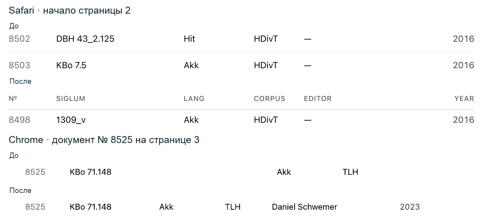

# Печать описи CTH 547 в Safari и Chrome

22 ноября 2026 года, Apple M1 Max, macOS Ventura 13.7.8 (22H730). Оба браузера печатали локальную опись полного корпуса на A4 в книжной ориентации. В поле поиска введено `cth 547`, группа раскрыта. Эталон – 62 строки исходного HTML, от № 8486 (`72_r`) до № 8547 (`KUB 37.230`). [Задача № 28](https://github.com/sergeyssimonov-max/Aruna/issues/28).

| Браузер | До исправления | После исправления |
|---|---|---|
| Safari 18.6 | Три страницы по 16, 25 и 21 документу. Заголовки колонок только на первой. | Три страницы по 12, 24 и 26 документов. На каждой странице перед первым документом видны все шесть заголовков. |
| Chrome 157.0.8103.79 | Четыре страницы по 13, 21, 21 и 7 документов. Нет заголовка редактора и значений редактора и года у всех 62 строк. | Четыре страницы по 14, 21, 21 и 6 документов. Все шесть заголовков есть на каждой странице. Редактор и год совпали с HTML у 62 из 62 строк. |



## Что проверено

- В обоих браузерах все 62 документа напечатались по одному разу в исходном порядке. У каждого документа совпали с HTML все шесть полей (372 значения). Для Safari сравнивался текст системного PDF, для Chrome – текст дополнительного PDF того же браузера, полученного через `Page.printToPDF`.
- Обе пары PDF до и после сохранены также через системный диалог печати. В растровом PDF Chrome отдельно сверены все номера, годы и редакторы. Из 62 редакторов три указаны по имени, в остальных 59 строках напечатан прочерк. Для № 8525 (`KBo 71.148`) видны `Daniel Schwemer` и `2023` в одной строке. Два номера, неверно прочитанные распознаванием текста, сверены на увеличенных фрагментах.
- В обоих браузерах запрос `KBo 71.148` дал одну печатную страницу с одним документом. После сворачивания CTH 547 напечаталось название группы и ни одного документа.
- В полном корпусе 23 936 документов и 663 группы. Счетчики и порядок документов и ссылок при открытии, поиске и очистке совпали с исходной описью во всех девяти состояниях проверки, отдельно в WebKit и Chrome.
- Два независимых экспорта дали побайтово одинаковые пакеты. При сравнении с исходным пакетом изменился только файл описи. Его размер вырос с 5 603 641 до 6 323 638 байт (+12,85%). SHA-256 исправленного HTML – `ee2bcfb2175f01f4697af8da8597e4fd3093d138faac0a623d834b74776039b1`.

Ветка основана на `7b24614`, исправленный код – `c94f144`. Системные PDF сняты при исходной `main` на `2e28945`. Между этими ревизиями базы обновились зависимость ESLint и перечень лицензий. После установки с новым lock-файлом все сгенерированные файлы описи побайтово совпали с проверенными при печати.

Прошли проверки фронтенда (`check`, `lint`, `format:check`, 410 модульных тестов), `cargo fmt`, Clippy со всеми фичами, 814 тестов Rust и `cargo deny check licenses bans sources`. В профиле nextest пропущены 11 тестов. Штатный аудит pnpm завершился с двумя ранее учтенными исключениями уровня moderate.

## Как повторить

Из корня checkout с установленными зависимостями выполнить:

```sh
pnpm --dir frontend build:inventory
out="$(mktemp -d)"
cargo run --locked -p aruna --example export_beta -- \
  cli/fixtures/TLHbasisONLINE25_1_ZENODO_Beta_03.zip "$out"
node frontend/scripts/bench-search.ts "$out/TLHdig_Beta_0.3" both --verify-order
```

Открыть `$out/TLHdig_Beta_0.3/TLHdig_Beta_0.3.html` в каждом браузере, найти `cth 547` и выбрать в системном диалоге печати все страницы, A4, книжную ориентацию и сохранение в PDF. Проверить заголовки в начале каждой страницы и строку № 8525 на третьей странице. Для полного сравнения сверить все шесть значений каждой строки с исходной описью.

В Safari используются печатные секции до 12 документов. Если на лист помещаются несколько секций, заголовки повторяются и внутри листа. Chrome использует обычный заголовок таблицы. Замеры относятся к указанным версиям браузеров и формату A4.
